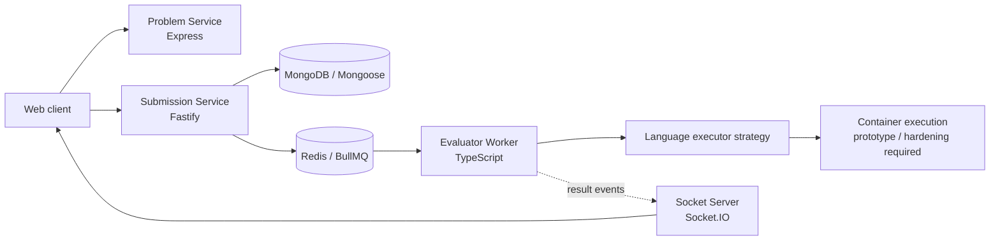

# Algoise — Coding Platform Backend

> **Status: Prototype / work in progress.** Algoise is a multi-service coding-platform project. The repository contains service implementations and supporting architecture work; it is not a hardened, production-ready online judge.

The backend is split into services with separate responsibilities: problem management, submission intake, asynchronous evaluation, and real-time client updates.

## Service map



This is a logical view of the intended service flow. It should not be interpreted as proof that every service-to-service integration or failure path is complete.

## Services

| Service | Responsibility | Current implementation evidence |
|---|---|---|
| `Algoise-Problem-Service` | Problem/admin API | Express application with `/api` route mounting and controller/service organisation |
| `Algoise-Submission-Service` | Accept and persist submissions, then enqueue evaluation | Fastify, Mongoose repository abstraction, BullMQ producer |
| `Algoise-Evaluator-Service` | Consume submission jobs and dispatch language-specific executors | TypeScript, BullMQ worker, executor factory, Dockerode dependency |
| `Algoise-Socket-Server` | Map connected users to socket IDs and deliver submission payload events | Express, Socket.IO, Redis-backed user-to-socket lookup |

The individual services are also available as standalone repositories under this GitHub account.

## Engineering themes

- Decomposing a backend workflow into independently owned service responsibilities.
- Separating synchronous submission intake from asynchronous evaluation.
- Using a queue to decouple request handling from code execution.
- Selecting language-specific execution strategies behind a factory.
- Using a realtime channel to deliver events to connected clients.

## Important limitations

The project is a prototype. Arbitrary code execution is a security boundary and this implementation must not be exposed to untrusted users without substantial work, including isolation, resource limits, network/filesystem restrictions, timeouts, output caps, and adversarial testing.

The submission path also needs a robust strategy for the database-write/queue-publish failure window, idempotent submission semantics, and observable retries. Worker completion and error propagation need additional testing before the system can be described as reliable.

## Repository structure

```text
Algoise_backend/
├── Algoise-Problem-Service/
├── Algoise-Submission-Service/
├── Algoise-Evaluator-Service/
├── Algoise-Socket-Server/
└── Socket-dumy-frontned/
```

Each service has its own dependencies and development command. See the service-level README for setup instructions.

## Suggested next milestones

1. Define versioned request, job, and result contracts shared across services.
2. Make queue publishing durable with an outbox or another explicit dual-write strategy.
3. Await worker execution and propagate failure/completion to BullMQ correctly.
4. Harden code execution and validate isolation with adversarial tests.
5. Add integration tests for submission-to-result flow, reconnects, duplicate jobs, and worker restarts.
6. Add central logs, trace/correlation IDs, metrics, and local orchestration for the full system.
7. Remove generated artifacts and runtime logs from Git; keep test output in CI artifacts instead.
